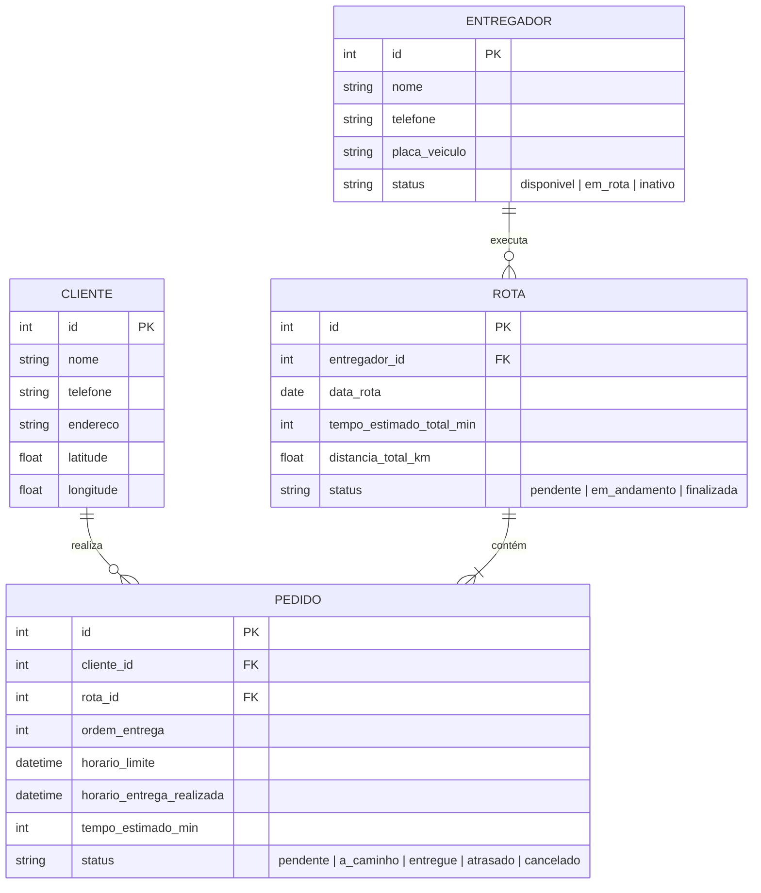

# 📦 Monitoramento de Entregas (MonitormentoBoy)
## Documento de Dores, Requisitos e Visão de Produto

---

## 1. 📌 Contexto e Visão Geral
A operação logística lida diariamente com uma base de clientes e um volume crescente de pedidos para entrega de produtos. Atualmente, a gestão das entregas e a alocação de pedidos para os entregadores (motoboys) dependem de processos manuais ou descentralizados, resultando em ineficiência operacional, custos elevados de trajeto e falta de previsibilidade de prazos.

O objetivo do **MonitormentoBoy** é ser um sistema inteligente de gestão logística e roteirização que:
1. Centraliza os dados de clientes, pedidos e entregadores.
2. Calcula rotas otimizadas e alternativas para suprir toda a demanda do dia.
3. Monitora em tempo real a pontualidade das entregas (no prazo vs. atrasadas).
4. Oferece interfaces dedicadas e intuitivas para o Administrador e para o Entregador.

---

## 2. 💥 A Dor do Negócio (Problemas Identificados)

| # | Problema Atual | Impacto no Negócio |
|---|---|---|
| **D1** | **Roteirização empírica e ineficiente** | Entregadores gastam mais tempo e combustível por não seguirem a sequência ideal de entregas. |
| **D2** | **Falta de visibilidade de atrasos em tempo real** | A gestão só descobre atrasos após reclamação do cliente, prejudicando a reputação da empresa. |
| **D3** | **Comunicação manual e falha com o entregador** | Falta de um canal centralizado para o motoboy visualizar a lista do dia e reportar conclusões de entrega. |
| **D4** | **Incapacidade de reagir a imprevistos** | Sem rotas alternativas calculadas, qualquer imprevisto no trânsito gera efeito cascata de atrasos. |
| **D5** | **Ausência de métricas operacionais** | Dificuldade em mensurar tempo médio de entrega, taxa de pontualidade e desempenho individual. |

---

## 3. 🎯 Objetivos do Sistema

- **Otimização de Trajeto:** Fornecer rotas inteligentes e alternativas considerando distância, tráfego e estimativa de tempo para cada entrega.
- **Painel de Controle em Tempo Real:** Permitir que o gestor identifique instantaneamente entregas no prazo e entregas críticas/atrasadas.
- **Operação Descomplicada para o Motoboy:** Aplicativo/painel simples para o entregador seguir a sequência de pedidos e dar baixa imediata ao entregar.
- **Rastreabilidade e Confiabilidade:** Histórico completo de status, horários de saída, previsão de chegada e confirmação de entrega.

---

## 4. 👥 Perfis de Usuário & Funcionalidades

### 4.1. 👨‍💼 Painel do Administrador (Gestão Operacional)
- **Cadastro e Gestão de Dados:**
  - Cadastro de Clientes (nome, endereço completo com geolocalização/CEP, telefone).
  - Cadastro de Pedidos (itens, prioridade, horário limite de entrega, cliente associado).
  - Gestão de Entregadores (dados, disponibilidade, capacidade máxima de carga/pedidos).
- **Roteirização Inteligente:**
  - Geração automática da melhor rota para cumprir a demanda do dia.
  - Disponibilização de rotas alternativas com simulação de tempo estimado e quilometragem.
  - Atribuição de rotas aos entregadores disponíveis.
- **Dashboard de Monitoramento (Tempo Real):**
  - **Filtro de Status:**
    - 🟢 *No Prazo:* Pedidos dentro da janela de entrega esperada.
    - 🔴 *Atrasadas / Risco:* Pedidos que ultrapassaram o tempo estimado ou horário limite.
    - 🔵 *Em Andamento:* Entregas em rota com previsão de chegada.
    - ✅ *Concluídas:* Entregas realizadas com sucesso no dia.
  - Mapa interativo exibindo a localização das entregas e rotas ativas.
  - Histórico de entregas e relatórios de desempenho operacional.

---

### 4.2. 🛵 Painel do Entregador (Interface Mobile/Responsiva)
- **Minhas Entregas do Dia:**
  - Lista ordenada dos pedidos a entregar hoje, segundo a melhor rota calculada.
  - Informações claras do cliente: Nome, endereço, instruções de entrega e horário limite.
- **Navegação & Trajeto:**
  - Exibição do tempo estimado e botão para abrir a rota em aplicativos de navegação (Google Maps / Waze).
  - Visualização de alternativas de caminho caso ocorra congestionamento ou obstáculo na via.
- **Ações Rápidas:**
  - Botão **"Marcar como Entregue"** com registro automático de data/hora (baixa instantânea refletida no painel admin).
  - Opção de registrar ocorrência (ex.: "Cliente ausente", "Endereço não localizado").

---

## 5. ⚙️ Requisitos do Sistema

### 5.1. Requisitos Funcionais (RF)
- `RF01`: O sistema deve permitir a entrada e importação de dados de clientes e pedidos.
- `RF02`: O sistema deve geocodificar os endereços dos clientes para coordenadas geográficas (latitude/longitude).
- `RF03`: O sistema deve calcular rotas otimizadas e trajetos alternativos com cálculo de distância e tempo estimado.
- `RF04`: O sistema deve sinalizar visualmente no painel administrativo as entregas em conformidade (no prazo) e não conformidade (atrasadas).
- `RF05`: O sistema deve listar para cada entregador apenas as entregas designadas para sua rota no dia atual.
- `RF06`: O entregador deve poder atualizar o status do pedido para "Entregue" em um único clique.
- `RF07`: A confirmação de entrega deve atualizar o painel do administrador em tempo real (via polling ou WebSockets).

### 5.2. Requisitos Não Funcionais (RNF)
- `RNF01` - **Usabilidade Mobile:** A tela do entregador deve ser leve, responsiva e de fácil interação com apenas uma mão.
- `RNF02` - **Desempenho:** O recálculo de rotas não deve ultrapassar 5 segundos para lotes usuais de entrega.
- `RNF03` - **Disponibilidade:** O sistema deve operar de forma confiável durante todo o expediente de entregas.
- `RNF04` - **Escalabilidade:** Arquitetura preparada para suportar aumento no volume de entregadores e pedidos diários.

---

## 6. 🗄️ Estrutura de Banco de Dados Proposta

---

## 7. 🖥️ Telas do Sistema (UI/UX)

1. **Autenticação:**
   - Login unificado com redirecionamento baseado no perfil (Admin vs. Entregador).
2. **Administração:**
   - **Dashboard Principal:** Indicadores rápidos (Total do dia, Concluídas, Pendentes, Atrasadas) + Mapa interativo.
   - **Módulo de Pedidos & Roteirização:** Tabela de pedidos com botão para "Gerar Rota Otimizada", selecionar rotas alternativas e designar motoboys.
   - **Gestão de Clientes e Entregadores:** CRUD completo de cadastros.
3. **Entregador:**
   - **Visão "Hoje":** Card com a próxima entrega em destaque, tempo estimado e botão de navegação.
   - **Checklist de Entregas:** Lista com ordenação otimizada e botão de confirmação de entrega.

---

## 8. 🚀 Próximas Etapas Recomendadas

1. **Definição da Stack Tecnológica:**
   - *Backend:* Node.js / Express ou Python / FastAPI.
   - *Frontend:* React / Next.js ou Vue (com layout responsivo PWA para o entregador).
   - *Banco de Dados:* PostgreSQL / SQLite com suporte a extensões geoespaciais (PostGIS se necessário).
   - *API de Mapas/Rotas:* OpenStreetMap (OSRM / Nominatim) para solução open-source, ou Google Maps API.
2. **Criação da Prova de Conceito (PoC):**
   - Implementação do algoritmo de roteirização com pontos de entrega simulados.
   - Criação do Dashboard do Administrador e do Painel do Entregador com atualização de status.