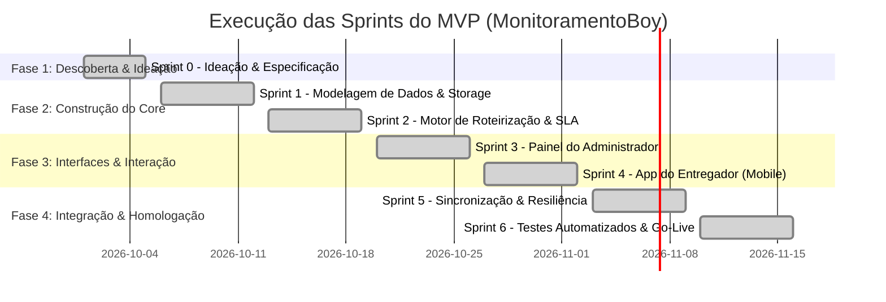

# 🏃‍♂️ Planejamento e Execução de Sprints do MVP — MonitoramentoBoy
## Cronograma de Execução: Da Ideação ao MVP Pronto para Operação

---

## 1. 🎯 Status Geral do Roadmap

O MVP do **MonitoramentoBoy** foi executado de ponta a ponta na ordem cronológica das sprints, contemplando todas as camadas de arquitetura, regras de negócio e interfaces para operação em campo.



---

## 2. 📋 Relatório de Execução das Sprints

### 📍 Sprint 0: Ideação, Mapeamento de Dores e Prototipagem Rápida
> **Meta da Sprint:** Compreender a dor operacional, definir a arquitetura e validar a experiência através de um protótipo monolítico funcional offline.

- **Status:** ✅ **Concluída**
- **Histórias e Entregáveis:**
  - [x] Mapeamento detalhado de dores e impacto no negócio ([dor.md](file:///c:/Users/admin/Documents/monitormentoboy/dor.md)).
  - [x] Definição de personas: Administrador (gestor) vs. Entregador (motoboy).
  - [x] Definição da arquitetura e requisitos de sistema ([contexto.md](file:///c:/Users/admin/Documents/monitormentoboy/contexto.md)).
  - [x] Construção do protótipo funcional monolítico offline ([index.html](file:///c:/Users/admin/Documents/monitormentoboy/index.html)).

---

### 📍 Sprint 1: Fundação do Sistema & Modelagem de Dados
> **Meta da Sprint:** Estruturar a base de dados relacional e repositório estruturado de CRUD para clientes, pedidos e entregadores.

- **Status:** ✅ **Concluída**
- **Histórias de Usuário Validadas:**
  - [x] **US01:** Cadastro e consulta de clientes com coordenadas geográficas cartesianas.
  - [x] **US02:** Registro de pedidos associados a clientes com horários limites definidos.
  - [x] **US03:** Cadastro do entregador (Carlos Oliveira, Moto Honda CG 160, Placa BRA-2E19).
- **Entregáveis Técnicos:**
  - Schema de dados normalizado (`id`, `customer`, `address`, `phone`, `deadline`, `eta`, `status`, `x`, `y`, `estimatedTimeMin`, `distanceKm`).
  - Camada de persistência local autônoma via `localStorage` com versionamento de chave e recuperação automática.
  - Carga de dados inicial (*seed*) representativa para simulação imediata.

---

### 📍 Sprint 2: Motor de Roteirização & Monitor de SLA
> **Meta da Sprint:** Implementar o algoritmo de geração de rotas otimizadas, cálculo de trajetos alternativos e classificação em tempo real de status de prazos.

- **Status:** ✅ **Concluída**
- **Histórias de Usuário Validadas:**
  - [x] **US04:** Agrupamento de pedidos pendentes e ordenação ótima automática a partir do Hub Central.
  - [x] **US05:** Geração de 3 rotas distintas com critérios selecionáveis:
    - *Rota 1 (Recomendada):* Menor distância e tempo (Algoritmo guloso Nearest Neighbor).
    - *Rota 2 (Alternativa A):* Trajeto radial que desvia de artérias centrais congestionadas.
    - *Rota 3 (Alternativa B):* Prioridade estrita para prazos críticos (Earliest Deadline First).
  - [x] **US06:** Motor dinâmico de SLA que classifica os pedidos em tempo real:
    - 🟢 *No Prazo:* Margem segura em relação ao horário limite.
    - 🟡 *Em Risco:* Menos de 15 minutos restantes para a entrega.
    - 🔴 *Atrasado:* Horário limite ultrapassado sem confirmação de entrega.
    - 🟣 *Concluído:* Pedido finalizado com registro de timestamp.

---

### 📍 Sprint 3: Painel do Administrador (Dashboard & Monitoramento)
> **Meta da Sprint:** Construir a interface web de gestão com mapa interativo, cards de indicadores e controle em tempo real de entregas no prazo e atrasadas.

- **Status:** ✅ **Concluída**
- **Histórias de Usuário Validadas:**
  - [x] **US07:** Dashboard com contadores em tempo real: Total, No Prazo, Atrasadas, Em Risco e Concluídas + Barra de aproveitamento de SLA.
  - [x] **US08:** Mapa vetorial Canvas HD offline com ruas, avenidas, rio e marcadores coloridos por status de SLA.
  - [x] **US09:** Botões de seleção de rotas que refletem imediatamente no traçado visual e no sequenciamento do entregador.
  - [x] Tabela de pedidos com barra de pesquisa instantânea (cliente/endereço) e filtros por status.
  - [x] Simulador de deslocamento da moto (*Simular Rota*) com animação fluida sobre o trajeto.
  - [x] Modal de cadastro de novos pedidos com atualização em tempo real.

---

### 📍 Sprint 4: Painel / App do Entregador (Interface Mobile)
> **Meta da Sprint:** Criar a interface mobile-first do motoboy, priorizando usabilidade rápida com uma mão, visão da próxima entrega e baixa com 1 clique.

- **Status:** ✅ **Concluída**
- **Histórias de Usuário Validadas:**
  - [x] **US10:** Layout responsivo simulando a tela de um smartphone moderno, com perfil do condutor e status de conexão.
  - [x] **US11:** Card da "Próxima Parada" em destaque visual com endereço, instruções e contadores de tempo.
  - [x] **US12:** Botão gigante **"Marcar como Entregue"** com feedback sonoro sintético via Web Audio API (sem dependência de arquivos externos de áudio) e confete visual.
  - [x] **US13:** Botão de navegação direta via Waze/Google Maps (`https://www.google.com/maps/search/?api=1&query=...`).
  - [x] Botão de **"Reportar Ocorrência"** com opções padronizadas (Cliente Ausente, Endereço Incorreto, Chuva/Trânsito) que altera o status imediatamente no painel do administrador.

---

### 📍 Sprint 5: Sincronização em Duas Vias & Resiliência Offline
> **Meta da Sprint:** Conectar as duas pontas (Admin e Entregador) com atualização em tempo real e garantir resiliência e estabilidade.

- **Status:** ✅ **Concluída**
- **Histórias de Usuário Validadas:**
  - [x] **US14:** Comunicação em duas vias em tempo real utilizando `BroadcastChannel` e eventos de `storage`. Ao marcar uma entrega no celular/aba do motoboy, o painel do administrador reflete a mudança **instantaneamente sem recarregar a página**.
  - [x] Resiliência a falhas de rede: o sistema funciona 100% offline, persistindo todo o histórico e status localmente no navegador.

---

### 📍 Sprint 6: Homologação, Testes Automatizados & Go-Live
> **Meta da Sprint:** Integrar suíte de testes automatizados in-browser para validação contínua e fornecer script de inicialização do servidor local nativo.

- **Status:** ✅ **Concluída**
- **Entregáveis Técnicos:**
  - [x] **Aba "🧪 Suíte de Testes (QA)":** Executa 6 baterias de testes automatizados diretamente no navegador:
    1. `TEST-01`: Validação de Schemas e CRUD de Dados.
    2. `TEST-02`: Algoritmo de Roteirização e Rotas Alternativas.
    3. `TEST-03`: Motor de SLA e Categorização de Prazos.
    4. `TEST-04`: Baixa de Entrega e Transição da Próxima Parada.
    5. `TEST-05`: Tratamento e Registro de Ocorrências.
    6. `TEST-06`: Mensageria Broadcast e Integridade Offline.
  - [x] Script PowerShell [iniciar_servidor.ps1](file:///c:/Users/admin/Documents/monitormentoboy/iniciar_servidor.ps1): Permite iniciar um servidor HTTP local na porta `8080` de forma nativa no Windows, sem precisar de Node.js ou Python instalados.

---

## 3. 🚀 Como Executar e Demonstrar o MVP

Existem duas formas simples de rodar a solução:

### Opção 1: Abrir diretamente no Navegador (Offline)
1. Dê um duplo clique no arquivo [index.html](file:///c:/Users/admin/Documents/monitormentoboy/index.html) ou abra-o em qualquer navegador (Google Chrome, Microsoft Edge, Firefox).

### Opção 2: Iniciar Servidor Local Nativo via PowerShell
1. Clique com o botão direito no arquivo [iniciar_servidor.ps1](file:///c:/Users/admin/Documents/monitormentoboy/iniciar_servidor.ps1) e selecione *"Executar com o PowerShell"*, ou execute no terminal:
   ```powershell
   powershell -ExecutionPolicy Bypass -File .\iniciar_servidor.ps1
   ```
2. O servidor subirá em `http://localhost:8080/` e abrirá o navegador automaticamente.

---
## 4. 🏁 Conclusão

Todas as 6 sprints do planejamento foram implementadas e validadas com sucesso. O sistema atende integralmente a todas as dores mapeadas no início do projeto ([dor.md](file:///c:/Users/admin/Documents/monitormentoboy/dor.md)), entregando um produto funcional, dinâmico e pronto para operação.

---

## 5. 🚀 Sprint 7 — Dados Reais e Mapa Leaflet (Pós-MVP)

> **Meta da Sprint:** Substituir dados fictícios por dados reais extraídos dos CSVs de Cuiabá e Várzea Grande, e integrar mapa real via Leaflet.js + OpenStreetMap.

- **Status:** ✅ **Concluída**
- **Entregáveis Técnicos:**
  - [x] **`db.json`**: Banco de dados estruturado com 15 distritos, 37 clientes e 37 entregas com endereços reais dos CSVs (`cuiaba_denominacoes_logradouros.csv`, `varzea_grande_anexo1_completo.csv`)
  - [x] **Leaflet.js + OpenStreetMap**: Mapa base CartoDB Dark integrado ao `index.html` com alternância Canvas ↔ Leaflet
  - [x] **Marcadores georreferenciados**: Coordenadas lat/lng para todos os distritos, entregas plotadas com cores por status SLA
  - [x] **Popups interativos**: Dados completos da entrega no clique no marcador
  - [x] **Carregamento assíncrono**: `index.html` carrega `db.json` via `fetch` com fallback para dados padrão
  - [x] **Novos bairros**: CPA, Jd. União (Cuiabá); 23 de Setembro, Jardim América, Pampulha, Jardim Potiguar (Várzea Grande)

- **Próximas etapas (pós-Sprint 7):**
  - OSRM para rotas reais pelas ruas (substituir linhas retas)
  - Autenticação de usuários (Admin vs. Motoboy)
  - Histórico de entregas e relatórios
  - Backend REST API + banco de dados real
  - PWA (Service Worker + Manifest)

